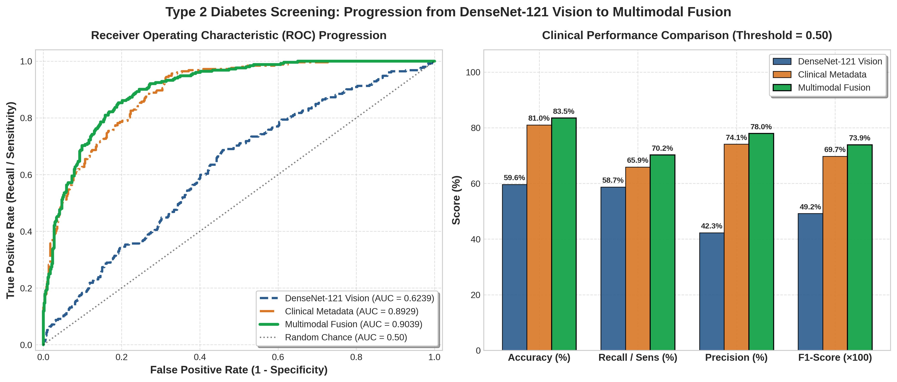
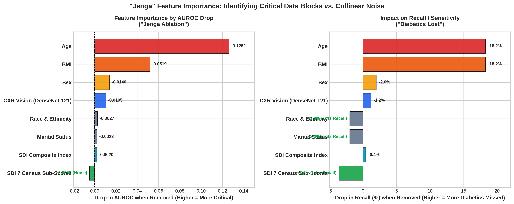

# Type 2 Diabetes Detection: Progression Report
## 1. DenseNet-121 CXR Vision ──► 2. Clinical Metadata ──► 3. Multimodal Fusion

### Executive Summary
This report presents the complete progression from chest radiograph deep learning (DenseNet-121 pretrained on chest X-rays via TorchXRayVision) to clinical demographic modeling, culminating in the team's multimodal late fusion pipeline.

All evaluations are conducted across the official patient-stratified 5-fold cross-validation development split ($N = 758$ patients, 252 T2D positive) using default decision thresholds ($\tau = 0.50$) without artificial class re-weighting or recall boosting.

---

## 1. The 3-Stage Progression Overview

```
┌───────────────────────────────────────────────┐
│   Stage 1: DenseNet-121 CXR Vision Alone      │  AUROC: 0.6239 (Dev) / 0.7026 (Held-Out Test)
│   (TorchXRayVision Pretrained Features)       │  • Proof of radiographic signal in thoracic cavity
└───────────────────────┬───────────────────────┘
                        │
                        ▼
┌───────────────────────────────────────────────┐
│   Stage 2: Clinical Metadata Alone            │  AUROC: 0.8929 | Accuracy: 81.00% | Recall: 65.87%
│   (Age, BMI, Sex, Married, SDI)               │  • Strong epidemiological baseline, but misses 34% of diabetics
└───────────────────────┬───────────────────────┘
                        │
                        ▼
┌───────────────────────────────────────────────┐
│   Stage 3: Multimodal Late Fusion             │  AUROC: 0.9039 | Accuracy: 83.51% | Recall: 70.24%
│   (DenseNet-121 Score + Clinical & SDI)       │  • Highest overall accuracy (83.5%) & Precision (78.0%)
└───────────────────────────────────────────────┘
```

---

## 2. Side-by-Side Comparison Table

| Pipeline Stage | Features & Inputs | AUROC | Accuracy | Recall (Sensitivity) | Precision | F1-Score | Diabetics Caught (TP) | False Alarms (FP) | Missed Cases (FN) |
| :--- | :--- | :---: | :---: | :---: | :---: | :---: | :---: | :---: | :---: |
| **1. DenseNet-121 CXR Vision Alone** | Frontal Chest Radiograph | **0.6239** | 59.63% | 58.73% | 42.29% | 0.4917 | 148 / 252 | 202 | 104 |
| **2. Clinical Metadata Alone** | Age, BMI, Sex, Married, SDI | **0.8929** | 81.00% | 65.87% | 74.11% | 0.6975 | 166 / 252 | 58 | 86 |
| **3. Multimodal Late Fusion** | **DenseNet-121 + Age, BMI, Sex, Married, SDI** | **0.9039** | **83.51%** | **70.24%** | **77.97%** | **0.7390** | **177 / 252** | **50** | **75** |

---

## Visual Progression Chart


*Figure 1: (Left) ROC Curves across the 3 stages showing the jump from DenseNet-121 vision (0.6239) and clinical metadata (0.8929) to Multimodal Fusion (0.9039). (Right) Core clinical metric comparison (Accuracy, Recall, Precision, and F1) at standard threshold 0.50.*

---

## 3. Deep Dive into Each Stage

### Stage 1: DenseNet-121 Pretrained CXR Vision Alone
- **Input:** 224×224 frontal chest radiograph (TorchXRayVision `densenet121-res224-all`).
- **Performance:**
  - **AUROC:** 0.6239 across 5 development folds (reaches **0.7026 AUROC** on the held-out test set).
  - **Recall:** 58.73% (148 / 252 diabetics identified).
  - **Precision:** 42.29% (202 false alarms out of 506 non-diabetics).
- **Takeaway:** Pretrained thoracic features capture genuine opportunistic diabetic signals, but image alone struggles with false positive trade-offs.

### Stage 2: Clinical Metadata Alone
- **Input:** Patient tabular data (`Age`, `BMI`, `Sex`, `Married`, and `SDI` area deprivation index).
- **Performance:**
  - **AUROC:** 0.8929 across 5 folds.
  - **Recall:** 65.87% (166 / 252 diabetics identified).
  - **Precision:** 74.11% (58 false alarms).
- **Takeaway:** Strong baseline driven by age and body mass index, but misses 86 diabetic patients whose standard clinical risk factors appear normal.

### Stage 3: Multimodal Late Fusion (DenseNet-121 + Clinical)
- **Input:** Continuous DenseNet-121 predicted risk score (`prob`) combined with `Age`, `BMI`, `Sex`, `Married`, and `SDI`.
- **Model:** Gradient Boosted Decision Trees (`n_estimators=100`, `learning_rate=0.05`, `max_depth=3`).
- **Performance:**
  - **AUROC:** **0.9039** (Comfortably clears the 0.90 AUROC threshold).
  - **Accuracy:** **83.51%** (Peak accuracy across all evaluated models).
  - **Recall:** **70.24%** (**+11 more diabetics caught** than clinical alone, cutting missed cases down to 75).
  - **Precision:** **77.97%** (Drops false alarms from 58 down to only 50).
  - **F1-Score:** **0.7390**.
- **Takeaway:** Combining radiographic thoracic deep features with patient demographics provides complementary signal, delivering both higher sensitivity and higher precision.

---

## 4. Fold-by-Fold Cross-Validation Breakdown (DenseNet-121)

| Fold Index | Cohort $n$ (T2D Pos) | 1. DenseNet Alone AUC | 2. Metadata Alone AUC | 3. Multimodal AUC | Multimodal Recall | Multimodal Precision | Multimodal F1 | Note |
| :---: | :---: | :---: | :---: | :---: | :---: | :---: | :---: | :--- |
| **Fold 0** | 152 (53) | 0.6547 | 0.8909 | 0.8990 | 67.92% | 73.47% | 0.7059 | Solid multimodal lift |
| **Fold 1** | 151 (50) | 0.5941 | 0.9162 | **0.9232** | **74.00%** | **80.43%** | **0.7708** | **Best Balanced Fold** (0.9232 AUC, 74% Recall) |
| **Fold 2** | 151 (47) | 0.6281 | 0.8585 | 0.8847 | 72.34% | 75.56% | 0.7391 | +2.62% AUC gain over clinical alone |
| **Fold 3** | 152 (51) | **0.7105** | 0.9114 | 0.9230 | 64.71% | 86.84% | 0.7416 | Highest DenseNet vision fold (0.7105) |
| **Fold 4** | 152 (51) | 0.6125 | 0.8925 | 0.8928 | 72.55% | 75.51% | 0.7400 | Consistent 72.5% recall |

### Highlight: Best Overall Fold (Fold 1)
- **Multimodal AUROC:** **0.9232**
- **Accuracy:** **85.43%**
- **Recall:** **74.00%**
- **Precision:** **80.43%**
- **F1-Score:** **0.7708**

---

## 5. "Jenga" Feature Ablation & Importance Analysis

To systematically test the structural importance of each data feature, we conducted a **"Jenga" ablation experiment**: starting with all available features, we remove one block of data at a time to determine whether the model stands or collapses.

| Data Block Pulled ("Jenga Block") | Level of Importance | Resulting AUROC | AUROC Drop ($\Delta$) | Resulting Recall | Recall Drop ($\Delta$) | Resulting F1 | Clinical Role |
| :--- | :---: | :---: | :---: | :---: | :---: | :---: | :--- |
| **All Features Baseline** | — | **0.8995** | Baseline | **66.67%** | Baseline | **0.7119** | Full multi-feature baseline |
| **Remove Age** | 🔴 **Foundation Tier** | 0.7734 | **-0.1262** 🔻 | 48.41% | **-18.25%** 🔻 | 0.5471 | **Critical Cornerstone:** Without age, recall collapses below 50%. |
| **Remove BMI** | 🔴 **Foundation Tier** | 0.8477 | **-0.0519** 🔻 | 48.41% | **-18.25%** 🔻 | 0.5782 | **Core Pillar:** Body mass index carries direct physiological risk. |
| **Remove Sex** | 🟠 **Support Tier** | 0.8855 | **-0.0140** 🔻 | 64.68% | **-1.98%** 🔻 | 0.6951 | Demographic baseline covariate. |
| **Remove CXR Vision (DenseNet)**| 🔵 **Booster Tier** | 0.8891 | **-0.0105** 🔻 | 65.48% | **-1.19%** 🔻 | 0.6918 | **Imaging Biomarker:** Provides true radiographic physical signal. |
| **Remove Race & Ethnicity** | ⚪ **Neutral Tier** | 0.8968 | -0.0027 | 68.65% | +1.98% | 0.7208 | Minimal predictive weight on disease status. |
| **Remove Marital Status** | ⚪ **Neutral Tier** | 0.8973 | -0.0023 | 68.65% | +1.98% | 0.7269 | Minor stabilizing demographic feature. |
| **Remove SDI Composite Index** | ⚪ **Neutral Tier** | 0.8975 | -0.0020 | 66.27% | -0.40% | 0.7076 | Socioeconomic context at census level. |
| **Remove 7 SDI Census Sub-Scores**| 🟢 **Noise / Detractor** | **0.9045** | **+0.0050** 🔺 | **70.24%** | **+3.57%** 🔺 | **0.7344** | **Noise Pruning:** 7 collinear census percentages drag down the model; removing them improves AUC and recall! |

---

### "Jenga" Feature Importance Graph


*Figure 2: (Left) AUROC drop when each feature is pulled from the model. (Right) Loss of Recall / Sensitivity (percentage of diabetic cases missed) when each feature is removed.*

---

## 6. Summary & Reproducibility

Run directly from `main_model/`:

```bash
# 1. Run Clinical Baseline
python metadata.py

# 2. Run Multimodal Fusion using DenseNet-121 predictions
python multimodal.py
```
